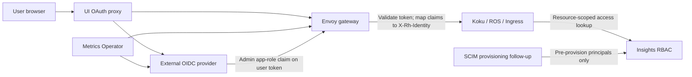

# COST-8520: External OIDC Providers for Cost Management On-Prem

**Status:** Draft for issue discussion; no implementation changes
**Issue:** [COST-8520](https://redhat.atlassian.net/browse/COST-8520)
**Initial provider to validate:** Microsoft Entra ID
**Scope:** Replace the required Keycloak-specific integration with configurable external OIDC; keep Insights RBAC.

**UI API token decision:** The target is a JWT OAuth access token for the Cost Management API. This follows the token type used by the Hybrid Cloud Console at its API boundary. The current SNO Keycloak ID-token path is a verified baseline to migrate, not a compatibility target.

## Summary

Allow Cost Management on-prem to authenticate through an externally managed OIDC provider—initially Microsoft Entra ID, with Okta, Ping Identity, and other compatible providers as targets—without requiring a Keycloak instance or Keycloak-specific configuration.

Preserve the current identity and authorization contracts:

- The external provider authenticates people and issues tokens.
- The on-prem gateway validates tokens and translates trusted claims into the existing `X-Rh-Identity` header.
- Koku continues to use Insights RBAC for permission checks, resource scoping, delegation, and the User Access experience.
- An administrator app-role claim maps to the existing `is_org_admin` identity flag. Insights RBAC applies the existing full `admin_default` bundle, including Cost Management, User Access/RBAC, Sources, and other currently seeded admin-default permissions.
- User-principal provisioning is separate from OIDC authentication. The current optional Keycloak sync is provider-specific; a provider-neutral provisioning replacement (recommended: SCIM 2.0) is a follow-up so non-admin principals can still be assigned permissions before first login.
- The Metrics Operator’s machine-to-machine token flow is configured independently from interactive user login.

OpenShift’s Entra login for the console and cluster API is configured independently. It does not automatically authenticate users to Cost Management; the Cost Management UI and API need their own OIDC client and gateway configuration.

## Goals

- Remove the required Keycloak-specific integration/configuration for Cost Management on-prem. The current operator does not deploy Keycloak; it requires customers to supply a Keycloak-compatible endpoint.
- Replace (not migrate) the operator CRD auth fields: the operator is unreleased, so `spec.auth.keycloak` is deleted outright. Keycloak stays a supported on-prem IDP configured through the same generic OIDC fields.
- Leave Cost Management SaaS (console.redhat.com) behavior completely untouched; this feature only changes on-prem deployments managed by the operator.
- Configure standards-based external OIDC issuers without Keycloak-specific URL, realm, endpoint, or claim assumptions.
- Preserve browser login, API authentication, Metrics Operator uploads, and the current full organization-admin experience.
- Preserve the `X-Rh-Identity` contract so backend services do not implement provider-specific token validation.
- Keep Insights RBAC as the authorization engine, including resource/verb ACLs, role delegation, and User Access functionality.
- Preserve Insights RBAC and explicitly track the separate user-principal provisioning capability required for pre-login role assignment.
- Fail closed for invalid tokens, invalid issuer/audience, missing organization/account mapping, and failed permission lookups.

## Non-goals

- Replacing Insights RBAC with Entra authorization. Entra claims supply identity and the configured admin-role signal; Koku and Insights RBAC continue to evaluate and enforce permissions.
- Reconfiguring the OpenShift cluster’s own OAuth/identity-provider configuration.
- Importing arbitrary Entra groups as Cost Management permissions. Only the configured organization-admin app role maps to the existing admin-default behavior; other permissions remain assigned through Insights RBAC.
- Implementing SCIM or per-provider directory-sync APIs inside the OIDC authentication change. Provisioning is not defined by OIDC and should be tracked separately if automated pre-provisioning is required across providers.
- Supporting multiple unrelated issuers in one deployment in the first iteration unless required by the issue’s acceptance criteria. Locked rule: the browser flow and the Metrics Operator flow always share the deployment’s single IDP.
- Changing SaaS behavior in any way: `koku-metrics-operator` keeps `api.console` as its default scope because it is released and serves SaaS.

## Current State and Verified Findings

The implementation target is **`koku-service-operator`**. Its README describes it as the operator for the on-prem stack. The live SNO deployment uses the `cost-onprem-chart` Helm chart; that chart is deprecated and is baseline evidence only, never an edit target. Implementation owner is `koku-service-operator`.

Current operator and live-deployment behavior:

- `spec.auth.keycloak` configures a Keycloak-shaped auth contract. Envoy derives a Keycloak JWKS URL, while oauth2-proxy uses `--provider=keycloak-oidc` and performs OIDC discovery from the issuer URL.
- Envoy maps the Keycloak realm role `org-admin` to `is_org_admin: true` in `X-Rh-Identity`.
- The current SNO UI proxy passes an OIDC token upstream with `--pass-authorization-header`, which oauth2-proxy v7.6.0 documents as the **ID token**. The target is an API **access token** for the Cost Management audience, not an ID token intended for the UI client.
- Koku runs with `ENHANCED_ORG_ADMIN=False`; it asks Insights RBAC for access. Insights RBAC applies its `admin_default` bundle when it sees `is_org_admin`.
- The current admin-default bundle includes Cost Administrator (`cost-management:*:*`), User Access administrator (`rbac:*:*`), Sources administrator (`sources:*:*`), and other seeded platform admin roles. This full bundle must be preserved.
- The optional `spec.rbac.keycloakSync` CronJob runs in the Insights RBAC container. It syncs members of top-level `org-{orgId}` Keycloak groups into RBAC Principals and can prune principals. The nested `org-admin` subgroup is only logged; it does **not** grant admin access. Admin access comes from the realm-role claim in the token.
- The current operator has no separate RBAC bootstrap-admin job. The first administrator gets the admin-default bundle from the token’s `org-admin` role; no existing RBAC principal/group assignment is required for that path.
- The Metrics Operator supports client-credentials token acquisition and a configurable token URL, but its request hardcodes `scope=api.console`.
- Koku consumes `X-Rh-Identity`; `Customer.org_id` is limited to 36 characters and Koku prefixes it with `org` to form the tenant schema.
- Insights Ingress consumes normalized `X-Rh-Identity` and its organization/account fields; it does not validate provider tokens itself.

## Hybrid Cloud Console Auth Precedent and COST-8520 Decision

The Console precedent supports the **access-token contract**, not a requirement to copy Console's complete auth infrastructure:

- Insights Chrome's OIDC connector implements `auth.getToken()` from the OIDC user's `access_token`; its security guidance describes sending that value as `Authorization: Bearer <token>` to API endpoints.
- Platform APIs expose the Bearer-token boundary through the Console API layer and deliver the normalized `X-Rh-Identity` contract to backend services such as Koku. Koku and Insights RBAC continue to authorize that identity; they do not need to become provider-specific OIDC clients.
- COST-8520 uses the same token category at the UI-to-API boundary, but keeps the on-prem components: oauth2-proxy manages the browser session, forwards the API access token through nginx, and Envoy validates it and maps trusted claims to `X-Rh-Identity`.

**Decision:** migrate the Keycloak UI path and configure external OIDC providers to use the same API-audience JWT access-token contract. The currently deployed SNO ID-token flow is characterization evidence only; it is not a legacy API-auth mode to preserve. Envoy must reject an ID token whose audience is only the UI client. This is an explicit migration because today's SNO flow has been observed to work with both token types, but that does not make the ID token the intended API credential.

References: [Insights Chrome OIDC connector](https://github.com/RedHatInsights/insights-chrome/blob/master/src/auth/OIDCConnector/OIDCSecured.tsx), [Chrome security guidance](https://github.com/RedHatInsights/insights-chrome/blob/master/docs/security-guidelines.md), and [Inventory identity requirements](https://github.com/RedHatInsights/insights-host-inventory/blob/master/docs/index.md#identity-requirements).

## Provider Compatibility Profiles

OIDC standardizes authentication and discovery, but it does not guarantee identical access-token formats, role/group claims, provisioning APIs, or machine-to-machine grant types. “Can sign a user in” is therefore not the same as “fully supports Cost Management on-prem.” Each provider profile must be checked against four contracts: UI login, an API access token Envoy can validate, the admin-role claim mapping, and a Metrics Operator token flow.

| Provider | User identity / org claims | Admin-role signal | Principal provisioning | Metrics Operator token flow | Initial compatibility note |
|---|---|---|---|---|---|
| **Keycloak (supported on-prem IDP)** | Realm-specific issuer; protocol mappers supply `org_id`, `account_number`, username, and email on access tokens. | Realm role `org-admin` appears in the token and maps to `is_org_admin`; the similarly named `org-admin` subgroup does not grant admin access. | Optional 15-minute Keycloak Admin API sync creates RBAC Principals from top-level organization groups; it does not assign admin permissions. | Client credentials with `api.console` scope (the KMO default); the token URL is configurable in the Metrics Operator CR. | Supported from the start as a generic OIDC profile; external OIDC deployments must not require Keycloak. MUST use a dedicated API audience (e.g. `cost-management-api`) added via an Audience mapper — never the UI client_id — so Envoy separates access tokens from ID tokens by audience. |
| **Microsoft Entra ID** | Tenant-specific issuer; `tid` and stable `oid` are available. `org_id=tid` only under the one-tenant-to-one-Cost-Management-org model; configure `account_number` separately. | Assign a security group an API app role; map the resulting `roles` value to `is_org_admin`. | Entra Graph adapter is provider-specific; SCIM is the cross-provider follow-up. | OAuth client credentials with API `/.default` application permission. | First end-to-end target. |
| **Okta** | Issuer is tied to the Okta org/authorization server. Do not assume the access-token `sub` is immutable; configure and verify a stable user-ID claim. Organization/account mapping is deployment-configured or claim-mapped. | A custom authorization server can issue configured group/custom claims; configure the expected claim/value. | Okta API adapter or SCIM; not part of OIDC itself. | Custom authorization server/client-credentials scope and API audience must be configured and tested. | Strong candidate for full support after its access-token and grant configuration is validated. |
| **Ping Identity** | Issuer, subject, and custom claims depend on the configured Ping product/authorization server; explicitly map stable subject and tenant/account. | Configure an API access-token claim carrying the approved admin-role value; do not assume a standard group claim. | SCIM or a separate Ping directory/API adapter; not part of OIDC itself. | Confirm the selected Ping authorization server supports the required client-credentials grant and API audience. | Candidate; validate the exact Ping product and profile before claiming support. |
| **Google Cloud Identity / Workspace** | Google OIDC supplies a stable `sub`; email/profile claims depend on requested scopes and may be absent. `hd` is a hosted-domain claim, not an organization/account ID. | Standard Google OIDC claims do not include an application admin-role/group claim. Use a supported custom claim/broker or a separate Google directory-group integration; do not infer admin from email domain alone. | Google Admin SDK/Cloud Identity integration or SCIM; separate from OIDC. | Google documents service-account JWT-bearer flows for server-to-server access, not Entra-style client credentials with an API `/.default` scope. The Metrics Operator needs a compatible grant implementation or another token issuer. | OIDC user sign-in may be possible, but do not claim full-stack support until API-audience tokens, admin-role signaling, and operator uploads are proven. |

The gateway requires a JWT access token with the Cost Management API audience. A provider’s OIDC ID token may be intended for the UI client, and a provider’s access token may be opaque or intended only for that provider’s APIs. The UI proxy must forward an API access token that Envoy can validate. Providers without that capability need an explicit token-validation/translation adapter or must be marked as login-only rather than full-stack supported. Audience-separation rule: a configured API audience must never equal a client_id whose ID tokens can reach the gateway; otherwise audience checks cannot separate ID tokens from access tokens. Entra, Okta, and Ping satisfy this structurally (separate client and resource registrations); Keycloak deployments must use a dedicated API audience (see the Keycloak profile).

Provider references: [Entra app roles](https://learn.microsoft.com/en-us/entra/identity-platform/howto-add-app-roles-in-apps), [Okta group claims](https://developer.okta.com/docs/guides/customize-tokens-groups-claim/main/), [Google OIDC claims](https://developers.google.com/identity/openid-connect/openid-connect), and [Google service-account OAuth](https://developers.google.com/identity/protocols/oauth2/service-account).

## Proposed Architecture

### Interactive user flow

1. The UI OAuth proxy redirects the browser to the configured provider using authorization-code flow with PKCE.
2. The proxy establishes a secure session and requests a delegated access token for the Cost Management API audience. It must forward that **API access token** to nginx (for example with oauth2-proxy `--pass-access-token`), and nginx must explicitly forward it to Envoy in a trusted header such as `X-Forwarded-Access-Token`. Forwarding an OIDC ID token is not sufficient.
3. Configure Envoy JWT authentication to read the UI token from that access-token header and the Metrics Operator token from its bearer `Authorization` header. Envoy validates signature, issuer, audience, expiry, and not-before time using the configured JWKS URI and trusted CA. It must accept the actual API token `aud`, not merely the UI OAuth client ID.
4. Envoy maps configured claims to `X-Rh-Identity`, replacing any client-supplied identity header.
5. If the user access token includes the configured administrator app-role claim, Envoy sets `is_org_admin: true`; otherwise it sets it false.
6. Koku asks Insights RBAC for access. Admins receive the existing full admin-default bundle; other users receive only their Insights RBAC assignments.

Entra group membership changes are reflected when a new token is issued/refreshed. Already-issued JWTs may remain valid until expiry. Removal latency also includes Entra claim propagation and cached RBAC responses. The effective bound is provider propagation + token lifetime/refresh + the deployed Koku/Insights RBAC cache TTLs; implementation must verify the effective values rather than assume a single default.

### Metrics Operator flow

1. The operator exchanges its client ID/secret for an access token using OAuth client credentials.
2. The operator requests the configured API resource scope. For Entra this is typically the API Application ID URI plus `/.default`, e.g. `api://<api-application-id>/.default`.
3. Envoy validates the service token’s issuer and API audience and maps its configured organization/account/service identity to `X-Rh-Identity` before routing the upload to Ingress.

The API Application ID URI identifies the Cost Management API resource; it is not the token endpoint URL and is not the current Keycloak scope `api.console`. The operator app needs the API’s application permission/app role and tenant admin consent. This is a coarse machine-client-to-API permission; it does not replace human-user permissions in Insights RBAC. The gateway must accept the actual `aud` value issued for this API resource.

Client-credentials tokens do not inherently contain the business `org_id`, `account_number`, or human username fields Koku expects. The trusted gateway mapping must derive `org_id` from the configured tenant mapping, obtain `account_number` from that mapping, and use a stable service-principal claim for the identity username. The resulting identity type/shape must preserve the current Metrics Operator upload behavior and be verified end-to-end.

## Entra Role and User Provisioning

### Organization-admin role

For Entra, define an API application role such as `CostManagement.OrgAdmin` and assign the organization’s admin security group to that role. The user access token must contain the configured role value in its `roles` claim. Envoy maps that claim/value to `is_org_admin`.

The Entra registration contract has three distinct pieces: (1) a Cost Management API resource/audience, (2) a delegated API scope requested by the UI OAuth client so the forwarded access token is for that API, and (3) an API app role assigned to the organization-admin group. The Metrics Operator uses a separate application app role granted to its client app. Entra v2 client-credentials requests use the API resource’s `/.default` scope; the UI uses a delegated scope, not `/.default`. If refresh-token-based sessions are required, configure `offline_access` if supported by the provider. Example names are illustrative; verify the actual token `aud` and claims before configuring Envoy.

This mirrors the current Keycloak realm-role flow and preserves the complete current admin-default bundle, including Cost Management, User Access/RBAC, Sources, and other currently seeded roles. The admin role must not be reduced to Cost Management-only access.

For Okta, Ping Identity, or another OIDC provider, configure an equivalent role/group claim and map its claim name/value through provider-neutral settings. OIDC does not standardize group/role claim names or formats; each provider needs a documented mapping. Do not interpret arbitrary group claims as administrators.

### User/principal provisioning boundary

OIDC standardizes authentication and token claims; it does not define a user/group provisioning API. The current optional `spec.rbac.keycloakSync` job is provider-specific: it reads Keycloak groups and creates Insights RBAC Principals. It does not grant the admin-default bundle; that comes from the admin-role claim in the token.

Pre-provisioning is needed when administrators must assign RBAC permissions before a non-admin’s first login. It is separate from OIDC login and from Insights RBAC authorization. Entra Graph is one provider-specific way to sync users, but it does not provide automatic principal sync for Okta, Ping, or every OIDC provider.

**Recommendation:** track provider-neutral directory provisioning (preferably SCIM 2.0) as a separate follow-up/dependency. It should create/update RBAC Principals only; membership in a provisioning group grants no Cost Management permissions. A separate admin app-role claim continues to activate the existing admin-default bundle. If provisioning is not included, do not claim that external OIDC alone preserves pre-login principal sync; deployments must use another supported principal-provisioning method.

The user’s agreed deprovisioning behavior for the future provisioning sync is: after a complete, successful reconciliation, a user removed from the configured provisioning population has their RBAC Principal and its assignments removed. A failed or incomplete sync must never prune principals. Removing a user from the admin app-role group is separate and takes effect on newly issued tokens.

## Provisioning Options and Operational Tradeoffs

Pre-provisioning means an Insights RBAC Principal exists before the user’s first Cost Management login, so an RBAC administrator can assign that user permissions in advance. Provisioning creates/updates/removes identities; it does not assign Cost Management roles. The Entra admin app-role claim remains the separate path for the full organization-admin bundle.

| Approach | Development effort | System-administrator effort | Provider coverage |
|---|---|---|---|
| **SCIM 2.0 push** | Medium-high initial investment for a secure SCIM endpoint, user lifecycle mapping, idempotency, audit, pagination/filter/PATCH behavior, and conformance tests. A user-only SCIM profile is smaller than full Users + Groups + Bulk support. | Configure SCIM base URL and bearer token in the IdP, map stable user ID/username/email/active fields, choose assigned-user/group scope, and test provisioning. Requires an HTTPS endpoint reachable from the IdP. | Broad across Entra, Okta, Ping, and other IdPs that support SCIM; each still needs an interoperability test.
| **Provider-specific API polling** | Lower/moderate for one provider using the existing scheduled sync pattern; high cumulative maintenance as each provider adds a different API, auth model, pagination, rate limits, and lifecycle semantics. | Create a provider API client, grant directory-read permissions/admin consent, store/rotate its secret or certificate, configure group IDs and schedule, and permit outbound API access from the cluster. | Each provider needs its own supported adapter (e.g. Graph for Entra, different APIs for Okta/Ping).
| **Manual RBAC provisioning** | Lowest implementation cost if the deployed Insights RBAC UI/API can create principals before first login; verify this capability for the on-prem version. | Administrators add each principal and assign roles manually; no IdP sync credentials or additional endpoint. | Provider-independent, but creates ongoing per-user operations.

**Recommendation:** because the desired provider set is broader than Entra, use SCIM 2.0 for provider-neutral pre-provisioning rather than building a permanent adapter per IdP. Keep it as a separate follow-up to COST-8520, which remains focused on OIDC authentication and token/claim mapping. Deliver SCIM before retiring the existing optional Keycloak principal-sync path for customers who rely on pre-provisioning. For constrained installations where the IdP cannot reach an inbound SCIM endpoint, a provider-specific outbound-polling adapter or a verified manual RBAC workflow is the fallback.

SCIM adds a new inbound trust boundary: secure the endpoint with TLS and a rotatable provisioning credential, restrict and monitor access, and fail safely on partial syncs. Provider polling avoids inbound exposure but needs outbound egress and high-value directory-read credentials. External OIDC itself already requires token/JWKS connectivity, but does not by itself provide provisioning.

### First administrator

No separate first-admin database bootstrap is required for the current admin-default flow. A user assigned the configured Entra admin app role receives `is_org_admin: true`; Insights RBAC applies the seeded admin-default bundle at request time, as it does for the current Keycloak realm role. RBAC permission seeding alone does not grant anyone admin access.

## Identity and Tenant Mapping

### `org_id`

Recommended for an initial single-tenant deployment: map the validated Entra `tid` claim to Koku `org_id` with hyphens stripped (32 lowercase hex chars), provided one Entra tenant corresponds to exactly one Cost Management organization. Rationale: the stripped value stays unique, fits Koku’s 36-char field with room to spare, and forms a schema name (`org<32hex>`) that is a safe unquoted Postgres identifier — unlike `org<guid-with-hyphens>`, which would require quoting in every raw-SQL path. The gateway must strip hyphens deterministically so RBAC principal matching and the future SCIM follow-up use the identical key.

If one Entra tenant must represent multiple Cost Management organizations, or one Cost Management organization spans multiple Entra tenants, use an explicit trusted mapping instead of `tid` directly.

### `account_number`

The gateway currently requires `account_number` separately from `org_id`. Provide it explicitly from a trusted claim or per-tenant Cost Management configuration. Do not silently assume it equals `tid`; it has a separate business meaning even if a deployment intentionally configures both to the same value.

### User identity and RBAC principal key

The identity-header username used by Koku and the username used by RBAC principal provisioning must match exactly. DECIDED Entra mapping: use immutable Entra `oid` as the canonical principal key; preserve `preferred_username`/email separately for display. For other providers, configure and verify a stable subject/user-ID claim rather than assuming `sub` or email is immutable. No migration concern: the operator is unreleased.

## Configuration Changes (Illustrative)

Final CRD field names are implementation decisions; the API should describe generic OIDC concepts rather than name the provider `Keycloak`.

### `koku-service-operator`

- Delete `spec.auth.keycloak` and add provider-neutral `spec.auth.oidc`: issuer URL, explicit JWKS URI (or discovery support), accepted audiences, TLS CA settings, UI client secret reference, claim mapping, and admin-role claim/value. No translation layer for old CRs: the operator is unreleased, so old CRs are rejected with a message naming `spec.auth.oidc`.
- Configure oauth2-proxy for generic OIDC (`provider=oidc`) with authorization-code/PKCE, issuer discovery, redirect URI, delegated API scope, explicit session email-claim mapping (Entra rarely emits `email`), access-token forwarding, secure cookies, and provider CA trust. Nginx must explicitly forward the access-token header to Envoy.
- Configure Envoy JWT authentication to read the UI access-token header and the Metrics Operator bearer token, with exact issuer, JWKS URI, audience(s), and role claim mapping. Do not derive Keycloak’s `/realms/{realm}/protocol/openid-connect/certs` path for arbitrary providers.
- Preserve `is_org_admin` mapping to the complete admin-default bundle and keep `ENHANCED_ORG_ADMIN=False` so Koku still consults Insights RBAC.
- Keep principal provisioning separate from authentication. Do not replace `spec.rbac.keycloakSync` with an Entra-only Graph adapter inside this OIDC-only issue. The external OIDC path must work with Keycloak sync disabled; retain the sync as a separately gated Keycloak-only capability and track SCIM/provider-neutral provisioning as a follow-up for customers who need pre-provisioning.
- Preserve the existing `X-Rh-Identity` output and network boundary around backend services. Drop `X-Bearer-Token` forwarding (verified: no on-prem reader).
- Document Keycloak as a first-class OIDC profile: same generic CR shape plus the Keycloak-side checklist (protocol mappers for `org_id`/`account_number`/roles on access tokens; a dedicated API audience distinct from the UI client_id (e.g. `cost-management-api`) added via an Audience mapper — never the `account` audience or the UI client_id; explicit `end_session_endpoint`).

### `koku-metrics-operator`

- Add a configurable scope/resource field under authentication and use it in the client-credentials request instead of hardcoded `api.console`.
- Keep the existing token URL and secret reference; clarify that they are provider-configurable.
- Preserve backward compatibility for existing configurations with a documented legacy default. Entra uses the API resource’s `/.default` scope.
- Generate/update the operator CRD, deepcopy code, manifests, and bundle for the additive field.

### Other components

- **Koku:** no issuer-specific change expected if the gateway preserves `X-Rh-Identity`; retain `RbacService`, tenant checks, and permission filtering.
- **Insights RBAC:** no authorization engine change; retain seeded roles, user delegation, and User Access API/UI.
- **Insights Ingress and ROS:** no direct provider-specific JWT validation if they keep receiving the normalized identity contract; verify their existing RBAC calls and identity handling in integration tests.
- **koku-ui:** likely no production auth-code change; the operator-managed OAuth proxy supplies the session/API token. Verify `/api/me`, logout, and embedded User Access UI behavior with provider claims.
- **OpenShift OAuth:** configure Entra for the cluster separately; it is outside this operator feature.
- **`cost-onprem-chart`:** deprecated; never an edit target. The live SNO chart deployment is baseline evidence only. Implementation target is `koku-service-operator`.

## Security and Failure Behavior

- Validate access tokens, not ID tokens, at the API gateway. Check signature, exact issuer, intended API audience, expiry, not-before, and TLS trust.
- Reject missing/invalid tenant ID or account mapping; never fall back to a shared tenant/account.
- Replace any incoming `X-Rh-Identity`; backends must not be reachable through an untrusted route that bypasses Envoy.
- Map only the explicitly configured admin claim/value; do not treat arbitrary group claims as administrator status.
- Keep `ENHANCED_ORG_ADMIN=False`; `is_org_admin` should activate Insights RBAC admin-default permissions, not bypass RBAC.
- Define and audit behavior for removal from the admin app-role group; revocation is reflected on newly issued tokens plus the relevant cache/token-expiry delay.
- If a SCIM provisioning follow-up is implemented, use least-privilege authentication, protected credentials, TLS verification, and safe deprovisioning that only prunes after a complete successful reconciliation.

## Acceptance Criteria

1. The operator-managed deployment can run with Entra without requiring a Keycloak deployment, Keycloak CR fields, realm, or Keycloak Admin API. Keycloak remains supported as a generic OIDC profile using the same API-audience access-token contract. Each additional provider is labeled full-stack supported only after passing the provider conformance checks below; OIDC login alone is not sufficient.
2. A user can log into the Cost Management UI through generic OIDC; secure session, delegated API access-token forwarding (not ID-token forwarding), refresh, and logout work.
3. Envoy accepts correctly issued API access tokens for configured issuer/audience and rejects ID tokens, bad signature, issuer, audience, expiry, or missing required identity fields.
4. Configured Entra `tid` maps to the expected `org_id` with hyphens stripped (32 hex chars); `account_number` comes from its explicit configured source; Koku uses the expected isolated tenant schema.
5. A user assigned the Entra organization-admin app role receives `is_org_admin=true`; Insights RBAC grants the complete existing admin-default bundle (Cost Management, User Access/RBAC, Sources, and currently seeded platform admin roles). A user without the claim does not receive that bundle.
6. Removing a user from the Entra admin group/role removes admin-default access on newly issued tokens; document/verify provider propagation, token lifetime, and RBAC cache TTL in the effective revocation bound.
7. An externally authenticated non-admin user with an existing/pre-provisioned Insights RBAC principal receives the same RBAC permissions and resource filters as today.
8. The Metrics Operator obtains a token with its configured resource scope and completes an upload through the gateway. Incorrect audience/scope is rejected. Its machine-to-machine grant remains separate from interactive UI authentication.
9. Koku, ROS, Ingress, and the UI continue using the existing identity and RBAC contracts; RBAC User Access and delegation functionality is retained.
10. Tests cover Entra role-claim mapping, generic OIDC claim mapping, invalid JWTs, admin-role addition/removal, and RBAC denial/allow behavior. Each provider marked full-stack supported must also pass API-token audience/claim and Metrics Operator grant/upload tests. Principal-provisioning tests belong to the SCIM/provider-provisioning follow-up.

## Open Decisions Before Implementation

1. **Pre-provisioning parity:** COST-8520 remains OIDC-only. The optional Keycloak principal sync is not portable; track provider-neutral SCIM 2.0 as a separate follow-up/dependency before retiring that capability for customers who rely on it.
2. **Account number:** what trusted value supplies `account_number` for each Entra tenant? Keep it distinct from `tid` by default.
3. **Canonical principal identifier:** DECIDED — Entra `oid` is the SCIM/RBAC key, mapped consistently into `X-Rh-Identity`; display username/email stay separate. No migration needed (operator unreleased).
4. **Entra app registration contract:** decide the API Application ID URI/audience, UI delegated API scope, operator application role, and admin app-role value. These must produce the audience and claims Envoy validates.
5. **OIDC discovery:** use configured issuer plus explicit JWKS URI (recommended for predictable Envoy config) or add provider discovery during reconciliation; confirm behavior with private CA and disconnected deployments.
6. **Provider compatibility:** define the minimum supported OIDC claims and how Okta/Ping configurations map their role claim names/values to the same admin claim contract.
7. **Logout behavior:** whether logout should end only the local oauth2-proxy session or also redirect through an optional provider end-session endpoint.
8. **Legacy configuration:** DECIDED — no backwards compatibility. `spec.auth.keycloak` is deleted; Keycloak is configured through the generic `spec.auth.oidc` fields (Keycloak profile). Old CRs are rejected with a message naming the new fields.

## Relevant Current Code

- `koku-service-operator/api/v1alpha1/costmanagementserviceconfig_types.go` — current `AuthConfig`, Keycloak settings, and `rbac.keycloakSync` fields.
- `koku-service-operator/internal/resources/envoy.go` — JWT/JWKS config and Keycloak realm-role to `is_org_admin` mapping.
- `koku-service-operator/internal/resources/ui.go` — current Keycloak-specific oauth2-proxy arguments.
- `koku-service-operator/internal/resources/scripts/sync_keycloak_principals.py` — current scheduled principal sync; subgroup is logged only.
- `koku-service-operator/docs/install/keycloak.md` — current admin-default behavior and Keycloak integration contract.
- `koku-metrics-operator/internal/crhchttp/config.go` and `api/v1beta1/metricsconfig_types.go` — client-credentials token scope and token URL CRD field.
- `koku/koku/koku/middleware.py` and `koku/koku/koku/rbac.py` — identity parsing and Insights RBAC access lookup.
- `koku/koku/api/iam/models.py` and `koku/koku/api/iam/serializers.py` — org ID limit and tenant schema construction.
- `insights-ingress-go/internal/upload/upload.go` — normalized identity use for upload requests.
